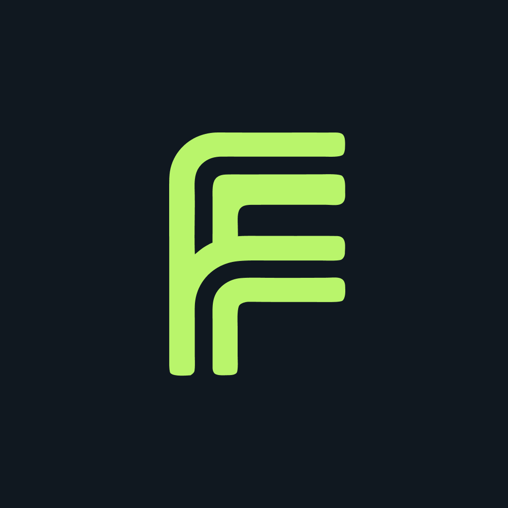

  

AI shouldn't belong only to big business.

We bring AI and automation to the tools small and medium businesses
already use, so their teams can get back to the work that matters.

## From AI talk to actual work

We build and manage practical workflows around the way a business
already operates: connecting tools, reducing repetitive tasks, and
keeping people in control of the decisions that matter.

From customer follow-ups to document processing and content publishing,
we start with a real business need and build toward a useful outcome.

## Behind the Work

This organization houses the platform, integrations, and tools
behind Flowgate ONE.

Our focus:
- Workflows built around existing tools and processes.
- Human approval where it matters.
- Clear visibility into what's running, waiting, or needs attention.
- Solutions we use ourselves before bringing them to customers.

[Explore Flowgate ONE](https://flowgate.one)

  

